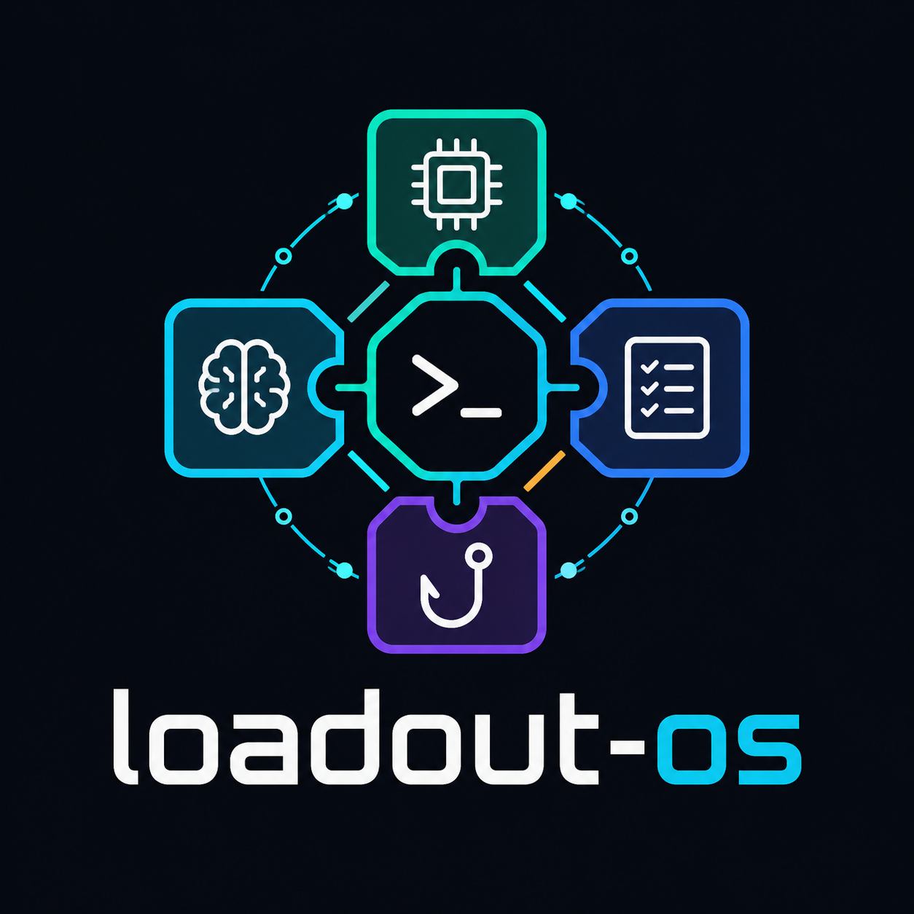

<p align="center"></p>

# @mcptoolshop/loadout-os

The unified **Knowledge OS** CLI. One `loadout-os` binary that wraps the three
library packages of this workspace and absorbs the operational rituals that used
to be a multi-step manual sequence.

It wraps:

- **kernel** — [`@mcptoolshop/ai-loadout`](https://github.com/mcp-tool-shop-org/loadout-os/tree/main/packages/kernel) — the knowledge router (resolve / match / budget / usage analysis)
- **memories** — [`@mcptoolshop/claude-memories`](https://github.com/mcp-tool-shop-org/loadout-os/tree/main/packages/memories) — `MEMORY.md` + sub-indexes → dispatch index
- **rules** — [`@mcptoolshop/claude-rules`](https://github.com/mcp-tool-shop-org/loadout-os/tree/main/packages/rules) — `CLAUDE.md` section analysis + rule-file linting
- the **runtime hooks** — [`apps/hook/loadout-hook.mjs`](https://github.com/mcp-tool-shop-org/loadout-os/tree/main/apps/hook) + `loadout-os hook <test|session-start|pre-compact|post-write|pre-tool>`

Every wrapped surface calls the library export directly (one process, one arg
parser, one structured-error shape) — `loadout-os` does not shell out to the
legacy `ai-loadout` / `claude-memories` / `claude-rules` bins.

## Command tree

### Namespaces (wrapped library surfaces)

```
loadout-os memories index          <MEMORY.md> [--id-source title|name] [--lazy] [--json]
loadout-os memories validate       <MEMORY.md> [--id-source title|name] [--max-lines <n>] [--max-bytes <n>] [--json]
loadout-os memories stats          <MEMORY.md> [--id-source title|name] [--json]
loadout-os memories health         [path] [--json]
loadout-os memories sync-summaries <MEMORY.md> [--fix] [--json]
loadout-os memories place          <topic.md> <index> [--store <dir>] [--into <index>] [--json]
loadout-os memories move           <topic.md> <index> [--store <dir>] [--into <index>] [--json]
loadout-os memories split          [<MEMORY.md>] --by <rules.json> [--store <dir>] [--id-source title|name] [--dry-run] [--json]

loadout-os rules analyze  <CLAUDE.md> [--rules-dir <dir>] [--json]
loadout-os rules validate [--rules-dir <dir>] [--lazy] [--repo-root <dir>] [--json]
loadout-os rules stats    <CLAUDE.md> [--rules-dir <dir>] [--json]
loadout-os rules split    [CLAUDE.md] [--yes] [--dry-run]   # interactive passthrough
```

### Flat verbs (knowledge router / kernel)

```
loadout-os resolve                  # resolve layered loadouts (global → org → project → session)
loadout-os explain <entry-id>       # how an entry resolved across layers
loadout-os usage <jsonl>            # usage summary from the event log
loadout-os dead <index> <jsonl>     # entries never loaded
loadout-os overlaps <index>         # keyword routing ambiguities
loadout-os budget <index> [jsonl]   # token budget breakdown
loadout-os validate <index>         # validate index STRUCTURE (kernel)
```

> **Name collision, resolved by namespacing.** The flat `validate <index>` is the
> kernel's index-structure validator. The store/rules linters are namespaced —
> `memories validate <MEMORY.md>` and `rules validate` — so all three coexist.

### Rituals & Hooks

```
loadout-os doctor [--store <dir>] [--index <p>] [--project-index <p>] [--settings <p>] [--skills <dir>] [--usage <p>] [--profiles <p>] [--repo-root <dir>] [--memory-warn-bytes <n>] [--subindex-warn-entries <n>] [--json]
loadout-os report [--index <p>] [--jsonl <p>] [--json]
loadout-os hook test [--prompt "<text>"] [--repo-root <dir>] [--json]
loadout-os hook session-start [--project <r>] [--store <dir>] [--user-prompt-submit]
loadout-os hook pre-compact   [--project <r>] [--store <dir>] [--stale-after-min <n>]
loadout-os hook post-write    [--project <r>] [--store <dir>] [--snapshot-repo <d>] [--mirror-repo <b>] [--fix]
loadout-os hook pre-tool      [--mode enforce|log-only] [--profiles <p>] [--log <p>] [--timeout-ms <ms>] [--now <iso|ms>]
loadout-os refresh [--store <d>] [--dest <p>] [--project <r>] [--profiles <p>] [--allow-store-change] [--id-source title|name] [--snapshot-repo <d>] [--mirror-repo <b>] [--fix] [--dry-run]
```

- **`doctor`** — read-only health screen (never writes) running 14 checks:
  - `store-validates` — validates `<store>/MEMORY.md` (`0` errors; refuses with `DEFAULT_STORE_REQUIRED` when no store is configured)
  - `memory-read-limit` — warns when `MEMORY.md` exceeds 60% of the 24.4 KB read limit (`14,640` B by default)
  - `subindex-entries` — warns when any sub-index (`index-*.md` or `metadata.loadout_role: subindex`) exceeds `60` entries
  - `index-parse` — parses and validates `~/.ai-loadout/index.json`
  - `hook-drift` — compares built `apps/hook/dist/loadout-hook.mjs` against `~/.claude/loadout-hook/loadout-hook.mjs`
  - `layers-malformed` — checks resolver search layers for malformed JSON
  - `core-entries` — warns if `0` core entries exist
  - `observability-loop` — checks `budget.avg_task_load_observed`
  - `hook-wired` — verifies `loadout-hook` in `settings.json`
  - `usage-growing` — checks `~/.ai-loadout/usage.jsonl` exists and is recent
  - `profiles-config` — reports validation warnings or parse failures in `profiles.json`
  - `triad-memories`, `triad-skills`, `triad-pretool-hook` — verifies pre-tool rule memory IDs per configured store, rule skill `SKILL.md` links, and `hooks.PreToolUse` `hook pre-tool` wiring in `settings.json`
  - `doctor` prints the resolved `store:` path and source (`flag`, `env`, or `profiles`). `--json` emits `{ checks, ok, store, storeSource }`. Exit `0` when all checks pass or warn; exit `1` on any fail.
- **`report`** — composes usage summary + dead-entry detection + token budget,
  plus a score distribution when usage events carry a `score`. `--json` for the
  machine-readable shape. Exit `2` when an input is missing. **Read-only.**
- **`memories split`** — mechanically splits root `MEMORY.md` entries into topic sub-indexes according to `--by <rules.json>`, preserves every entry and priority, writes nothing on `--dry-run`, and refuses with `ENTRY_COUNT_MISMATCH` / `PRIORITY_MISMATCH` on mismatch.
- **`hook test`** — runs the real `loadout-hook.mjs` against a sample prompt in an
  isolated HOME so the live `usage.jsonl` is never written.
- **`hook session-start`** — `SessionStart` hook that prints every `core` entry
  marked `metadata.loadout_inject: session-start` in full as UTF-8 under a file
  header, enforces line/byte caps with a visible truncation note, checks
  `metadata.stale_after_min`, and auto-refreshes if any `<store>/*.md` is newer
  than the project `index.json`. Pass `--user-prompt-submit` to emit only the stale warning.
- **`hook pre-compact`** — `PreCompact` hook that warns on stdout when the
  session-start board is older than `stale_after_min` before compaction.
- **`hook post-write`** — `PostToolUse` hook for `Write`/`Edit`: validates and
  refreshes the project index when the edited file is inside the memory store
  (resolved via `index.source`). Exits `2` on any failure (for `asyncRewake`)
  and `0` silently otherwise.
- **`hook pre-tool`** — `PreToolUse` guard (`Bash`, `Write`, `Edit`, `MultiEdit`): passes read-only tools and read-only Bash segments silently (`exit 0`), selects the active profile from `~/.ai-loadout/profiles.json` (`--profiles <p>` or `AI_LOADOUT_PROFILES_PATH`; default profile is `default`), evaluates the 5-rule Layer A/B table (`unreviewed-merge`, `quote-gate`, `memory-shell-write`, `future-stamp`, `release-reminder`), protects stores configured in `profiles.json`, `AI_LOADOUT_STORE`, and `~/.claude/projects/*/memory`, logs hashed decisions (`input_hash`) to `~/.ai-loadout/hook-decisions.jsonl`, and exits `2` with stderr only when a Layer A block rule fires in `enforce` mode. Warn-only rules (`unreviewed-merge` and `release-reminder`) clamp any `"block"` override to `"warn"` (`"off"` stays allowed).
- **`refresh`** — regenerates the store index → validates (andon halt on error) → rewrites relative paths to absolute + writes `~/.ai-loadout/index.json` (or `<project>/.claude/loadout/index.json` with `--project <root>`), serialized under an OS file lock. Guards cross-store overwrites with `STORE_MISMATCH` unless `--allow-store-change` is passed, and preserves prior-store backups (`<dest>.<sha>.bak`).

## Store resolution (`defaultStore`, `AI_LOADOUT_STORE`, `--store`)

Global `refresh` (without `--project`) and `doctor` resolve the default memory store in strict precedence order:

1. `--store <dir>` CLI flag
2. `AI_LOADOUT_STORE` environment variable
3. `defaultStore` in the active `profiles.json` (`--profiles <p>`, `AI_LOADOUT_PROFILES_PATH`, or `~/.ai-loadout/profiles.json`)

Neither command falls back to `process.cwd()`. When none of the three is set, global `refresh` refuses (`DEFAULT_STORE_REQUIRED`, exit `2`) and `doctor` fails `store-validates` (`DEFAULT_STORE_REQUIRED`, exit `1`). `refresh --project <root>` resolves `--store` or the project's `profiles.<prefix>.store` / `stores` entry, refusing with `PROJECT_STORE_REQUIRED` (exit `2`) when unset.

## Build & test

```
npm run build    # tsc
npm test         # node --test dist/tests/*.test.js
npm run verify   # tsc --noEmit && node --test dist/tests/*.test.js
```
