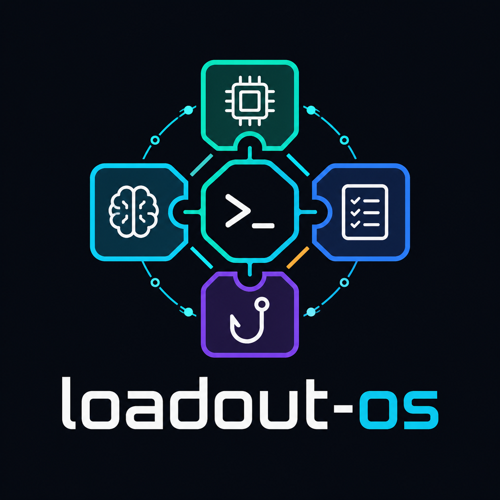

<p align="center"></p>

# @mcptoolshop/loadout-os

The unified **Knowledge OS** CLI. One `loadout-os` binary that wraps the three
library packages of this workspace and absorbs the operational rituals that used
to be a multi-step manual sequence.

It wraps:

- **kernel** — [`@mcptoolshop/ai-loadout`](../kernel) — the knowledge router (resolve / match / budget / usage analysis)
- **memories** — [`@mcptoolshop/claude-memories`](../memories) — MEMORY.md + sub-indexes → dispatch index
- **rules** — [`@mcptoolshop/claude-rules`](../rules) — CLAUDE.md section analysis + rule-file linting
- the **runtime hooks** — [`apps/hook/loadout-hook.mjs`](../../apps/hook) + `loadout-os hook <session-start|pre-compact|post-write>`

Every wrapped surface calls the library export directly (one process, one arg
parser, one structured-error shape) — `loadout-os` does not shell out to the
legacy `ai-loadout` / `claude-memories` / `claude-rules` bins.

## Command tree

### Namespaces (wrapped library surfaces)

```
loadout-os memories index          <MEMORY.md> [--lazy] [--json]
loadout-os memories validate       <MEMORY.md> [--max-lines <n>] [--max-bytes <n>] [--json]
loadout-os memories stats          <MEMORY.md> [--json]
loadout-os memories health         [path] [--json]
loadout-os memories sync-summaries <MEMORY.md> [--dry-run] [--json]
loadout-os memories place          <MEMORY.md> <topic.md> [--target <file>] [--json]
loadout-os memories move           <MEMORY.md> <topic.md> --to <file> [--json]

loadout-os rules analyze  <CLAUDE.md> [--rules-dir <dir>] [--json]
loadout-os rules validate [--rules-dir <dir>] [--lazy] [--repo-root <dir>] [--json]
loadout-os rules stats    <CLAUDE.md> [--rules-dir <dir>] [--json]
loadout-os rules split    # interactive — wrapped via passthrough to the claude-rules bin
```

### Flat verbs (knowledge router / kernel)

```
loadout-os resolve                  # resolve layered loadouts (global → org → project → session)
loadout-os explain <entry-id>       # how an entry resolved across layers
loadout-os usage <jsonl>            # usage summary from the event log
loadout-os dead <index> <jsonl>     # entries never loaded
loadout-os overlaps <index>         # keyword routing ambiguities
loadout-os budget <index> [jsonl]   # token budget breakdown
loadout-os validate <index>         # validate index STRUCTURE (kernel)
```

> **Name collision, resolved by namespacing.** The flat `validate <index>` is the
> kernel's index-structure validator. The store/rules linters are namespaced —
> `memories validate <MEMORY.md>` and `rules validate` — so all three coexist.

### Rituals & Hooks

```
loadout-os doctor [--json]                    # read-only health screen
loadout-os report [--index <p>] [--jsonl <p>] # observability over usage.jsonl
loadout-os hook test [--prompt "<text>"]      # drive the runtime hook on a sample prompt
loadout-os hook session-start [--project <r>] [--user-prompt-submit]
loadout-os hook pre-compact   [--project <r>]
loadout-os hook post-write    [--project <r>] [--snapshot-repo <d>] [--mirror-repo <b>] [--fix]
loadout-os refresh [--store <d>] [--dest <p>] [--project <r>] [--snapshot-repo <d>] [--mirror-repo <b>] [--fix] [--dry-run]
```

- **`doctor`** — one read-only screen: store `MEMORY.md` validates, the global
  index parses + validates, the runtime hook mirror matches the repo source (drift
  check), no malformed resolver layers, at least one core entry, observability
  loop wired, hook wired in `settings.json`, and `usage.jsonl` growing. `--json`
  emits `{ checks: [{ id, status, message, hint }], ok }`. Exit 0 when all checks
  pass or warn; exit 1 on any fail. **Never writes.**
- **`report`** — composes usage summary + dead-entry detection + token budget,
  plus a score distribution when usage events carry a `score`. `--json` for the
  machine-readable shape. Exit 2 when an input is missing. **Read-only.**
- **`hook test`** — runs the real `loadout-hook.mjs` against a sample prompt in an
  isolated HOME so the live `usage.jsonl` is never written.
- **`hook session-start`** — `SessionStart` hook that prints every `core` entry
  marked `metadata.loadout_inject: session-start` in full as UTF-8 under a file
  header, enforces line/byte caps with a visible truncation note, checks
  `metadata.stale_after_min`, and auto-refreshes if any `<store>/*.md` is newer
  than the project `index.json` (catching shell edits that skip `PostToolUse`).
  Pass `--user-prompt-submit` to emit only the stale warning.
- **`hook pre-compact`** — `PreCompact` hook that warns on stdout when the
  session-start board is older than `stale_after_min` before compaction.
- **`hook post-write`** — `PostToolUse` hook for `Write`/`Edit`: validates and
  refreshes the project index when the edited file is inside the memory store
  (resolved via `index.source`). Exits `2` on any failure (for `asyncRewake`)
  and `0` silently otherwise.
- **`refresh`** — folds the Index Freshness Ritual into one command: regenerate the
  store index → validate (andon halt on any error) → rewrite relative paths to
  absolute + publish to `~/.ai-loadout/index.json` (or `<project>/.claude/loadout/index.json`
  when `--project <root>` is passed), serialized under an OS file lock. Supports
  optional `--snapshot-repo <dir>` and `--mirror-repo <bare>` git snapshots.

## Build & test

```
npm run build    # tsc
npm test         # node --test dist/tests/*.test.js
npm run verify   # tsc --noEmit && node --test dist/tests/*.test.js
```

## SDK use

Importing the package is side-effect-free — the dispatcher only runs when the
file is the process entrypoint. Composable exports: `dispatch`, `runDoctor` /
`buildReport` / `runHookTest` / `runSessionStart` / `runPostWrite` (and their
`print*` renderers + `default*Paths` helpers).
